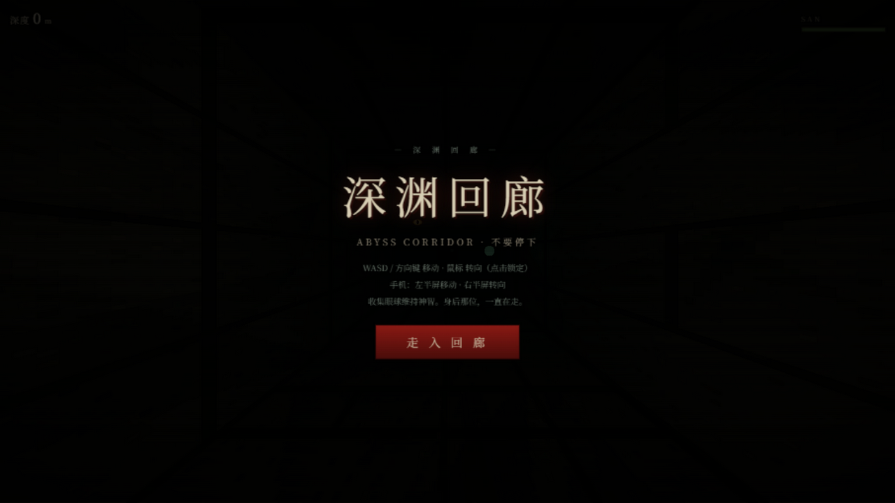
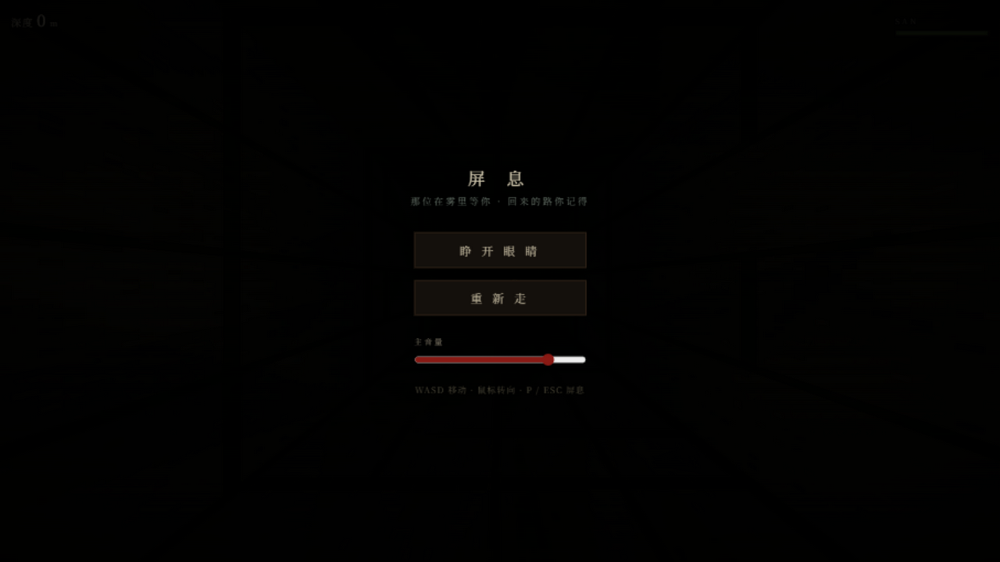

# 深渊回廊 · ABYSS CORRIDOR

纯代码 3D 克系无尽逃亡。回廊在雾里无尽延伸，墙上陆续睁开眼睛，身后那位一直在走——你停下，它就到了。

- **WASD / 方向键** 移动，**鼠标**转向（点击画面锁定指针）；手机**左半屏**移动、**右半屏**转向
- **P / ESC** 屏息（暂停）：切窗自动屏息；暂停面板可调主音量
- 最高深度本地留存，死亡结算显示纪录
- 收集绿色的眼球供品：回复 SAN，并把身后那位压远一点
- SAN 随时间流逝：雾变红、心跳变急、墙上红眼变多；SAN 低时它走得更快
- 深度（米）就是分数。它追上你，回廊合拢

## 实机画面

| 入口 | 屏息暂停 |
| --- | --- |
|  |  |

## 运行

纯静态，无需构建：

```bash
python3 -m http.server 8000
# 打开 http://localhost:8000
```

（直接双击 index.html 也可以。音频需要一次点击后才会开始——浏览器规矩。）

## 纯代码清单

没有任何模型、贴图、音频文件（唯一的依赖是 three.js 本体）：

- 石墙 / 地面 / 天花板纹理：canvas 程序绘制（噪斑 + 错缝石砖 + 颗粒）
- 墙上的眼睛与它的红眼：canvas 径向渐变贴图，会眨、会看
- 回廊：贪吃蛇式折线生成（直行 76% / 左右转各 12%），玩家前方生成、身后回收
- 供品眼球：自发光球体 + 点光源，悬浮旋转
- 追逐者：聚合暗球 + 雾中红眼，逼近速度随你的移动与 SAN 变化；它穿墙，你只看得见眼睛
- 音效：WebAudio 全合成——深渊底噪、SAN 驱动的心跳、脚步、供品清鸣、逼近低吼
